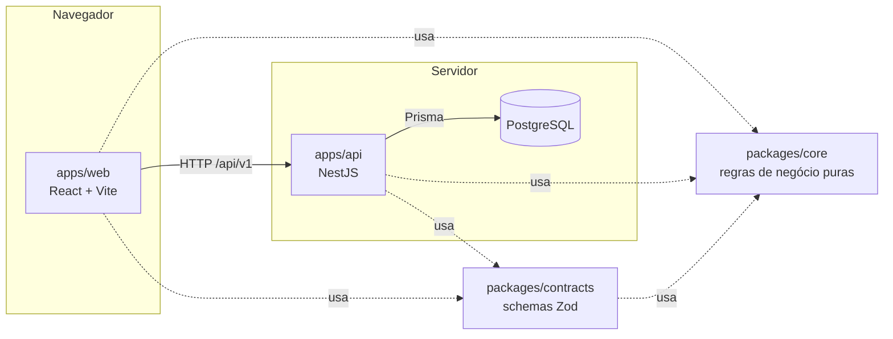

# Contadim

[](https://github.com/matheushromao/Contadim/actions/workflows/ci.yml)
[](./LICENSE)

**Controle financeiro pessoal, simples e gratuito.** Anote os gastos do dia a dia em segundos, veja para onde o dinheiro foi no mês, acompanhe as faturas e parcelas do cartão de crédito e, em breve, suas metas de economia.

O Contadim é feito para quem **não entende de finanças e não quer planilha**: abriu, digitou o valor, escolheu a categoria, pronto. Em português, em reais, pensado primeiro para o celular.

> Projeto open source e em evolução. Contribuições são muito bem-vindas, e o [CONTRIBUTING.md](./CONTRIBUTING.md) mostra como começar em poucos minutos.

---

## Sumário

- [O que já dá para fazer](#o-que-já-dá-para-fazer-v02)
- [Como o cartão de crédito funciona](#como-o-cartão-de-crédito-funciona)
- [Como rodar](#como-rodar)
- [Arquitetura](#arquitetura)
- [API](#api)
- [Testes e qualidade](#testes-e-qualidade)
- [Deploy](#deploy)
- [Roadmap](#roadmap)
- [Como contribuir](#como-contribuir)

## O que já dá para fazer (v0.2)

- **Lançamento rápido:** só valor e categoria são obrigatórios. Data (hoje) e "pagar com" (a última conta ou cartão usado) já vêm preenchidos. No cartão, dá para parcelar em até 24x, com a prévia das parcelas na hora.
- **Cartão de crédito:** faturas por ciclo, parcelas distribuídas nos meses seguintes, limite disponível, status da fatura (aberta, fechada, paga, vencida) e pagamento total ou parcial a partir de uma conta.
- **Resumo do mês:** receitas, despesas, saldo, "para onde foi o dinheiro" (gastos por categoria) e as faturas que vencem no mês, com navegação entre meses.
- **Lançamentos:** lista por mês agrupada por dia (e as parcelas de cartão agrupadas por cartão), com filtro por tipo, edição e exclusão.
- **Contas** (corrente, poupança, carteira) com saldo atual, e **categorias** personalizáveis (cor e ícone). Toda conta nova já começa com categorias padrão e uma "Carteira".
- **Conta de usuário** com e-mail e senha, e sessão segura que se renova sozinha.
- **Seus dados são seus (LGPD):** exportação completa em JSON e exclusão definitiva da conta.

## Como o cartão de crédito funciona

As regras ficam em `packages/core/src/cards`, como funções puras e testadas, e a API e o front usam as mesmas funções.

- **Cada fatura é identificada pelo mês de vencimento.** Um cartão que fecha no dia 3 e vence no dia 10 tem a "fatura de dezembro", que fecha em 3/12 e vence em 10/12.
- **Compras a partir do dia do fechamento** (inclusive) vão para a fatura seguinte.
- **Dias que não existem no mês** são ajustados para o último dia: um fechamento no dia 31 cai em 28/29 em fevereiro.
- **Parcelamento:** o valor total é dividido em parcelas iguais, e os centavos que sobram vão na 1ª (R$ 10,00 em 3x = 3,34 + 3,33 + 3,33). A 1ª parcela cai na fatura da compra, e as demais nos meses seguintes.
- **No resumo, a compra conta no mês da fatura.** Uma compra de R$ 300 em 3x aparece como R$ 100 em cada um dos três meses.
- **Pagar a fatura** registra a saída de uma conta. O saldo da conta diminui, mas o pagamento **não** conta como despesa de novo, porque as compras já contaram.
- **Pagamento parcial** é permitido. O que faltar continua na mesma fatura. Ainda não existe rotativo nem juros.
- **Limite disponível** é o limite menos tudo o que está em aberto, incluindo parcelas futuras.
- **Mudar o dia de fechamento ou vencimento** vale só para compras novas.

## Como rodar

Há duas formas. Escolha a que fizer mais sentido para você.

### Opção A: tudo em container (só precisa de Docker)

Ideal para conhecer o projeto sem instalar Node nem pnpm.

```bash
git clone https://github.com/matheushromao/Contadim.git contadim
cd contadim
cp .env.example .env
docker compose --profile full up --build
```

Quando os três serviços estiverem saudáveis, acesse:

| O quê         | Onde                           |
| ------------- | ------------------------------ |
| App           | http://localhost:8080          |
| API (Swagger) | http://localhost:3000/api/docs |
| Health check  | http://localhost:3000/health   |

As migrations do banco rodam sozinhas quando a API sobe. Para parar: `Ctrl+C` e depois `docker compose --profile full down`. Os dados ficam no volume `pgdata`; para apagá-los, use `down -v`.

### Opção B: desenvolvimento (`pnpm dev` + banco no Docker)

O fluxo do dia a dia de quem vai mexer no código, com hot reload na API e no front.

**Pré-requisitos:** Node.js 24 (há um `.nvmrc`), [pnpm](https://pnpm.io) (via `corepack enable`) e Docker.

```bash
git clone https://github.com/matheushromao/Contadim.git contadim
cd contadim
corepack enable
cp .env.example .env
pnpm install
pnpm db:up        # PostgreSQL no Docker (cria também o banco de testes)
pnpm db:migrate   # aplica as migrations
pnpm dev          # API em :3000 e web em :5173
```

Acesse **http://localhost:5173**. Em dev, o Vite encaminha `/api` para a API, então front e API ficam na mesma origem e o cookie de sessão funciona sem configurar CORS.

> A porta 5432 já está em uso? Mude `POSTGRES_PORT` no `.env` e ajuste a porta em `DATABASE_URL` e `DATABASE_URL_TEST`.

### Scripts úteis (na raiz)

| Script                              | O que faz                                                         |
| ----------------------------------- | ----------------------------------------------------------------- |
| `pnpm dev`                          | Sobe API, web e o build em modo watch de `core`/`contracts`       |
| `pnpm build`                        | Build de todos os pacotes                                         |
| `pnpm test`                         | Testes unitários e de integração (precisa do banco: `pnpm db:up`) |
| `pnpm lint` / `pnpm typecheck`      | ESLint e TypeScript em todo o monorepo                            |
| `pnpm format` / `pnpm format:check` | Prettier                                                          |
| `pnpm db:up` / `pnpm db:down`       | Sobe/derruba o PostgreSQL                                         |
| `pnpm db:migrate`                   | Cria/aplica migrations em desenvolvimento                         |
| `pnpm db:studio`                    | Abre o Prisma Studio para ver os dados                            |
| `pnpm docker:full`                  | Sobe a stack completa em container                                |

Todas as variáveis de ambiente estão documentadas no [`.env.example`](./.env.example). Um único `.env` na raiz serve para API, front e Docker Compose.

## Arquitetura

Um **monólito modular** com front-end e back-end separados: simples de rodar e de entender, mas organizado para crescer. A API é **stateless** (sessão em JWT + refresh token no banco), então dá para escalar horizontalmente sem mudar o código.



### Estrutura do monorepo

```
apps/
  api/          → back-end NestJS (módulos por domínio)
  web/          → front-end React (features por domínio)
packages/
  core/         → regras de negócio puras: dinheiro, datas, resumo mensal
  contracts/    → schemas Zod e tipos compartilhados (os contratos da API)
  config/       → tsconfig, ESLint e Prettier compartilhados
docker/         → scripts de inicialização do PostgreSQL
```

Ferramentas: **pnpm workspaces** + **Turborepo** (cache e ordem de build), **TypeScript `strict`** em todos os pacotes.

### Princípios

- **Regras de negócio em `packages/core`**, como funções puras e testadas, sem dependência de framework, banco ou UI. Controllers e componentes não calculam nada de negócio.
- **Contratos únicos em `packages/contracts`:** o mesmo schema Zod valida o formulário no front e a requisição na API, e gera a documentação Swagger. Mudou o contrato? O TypeScript aponta tudo o que precisa ser ajustado nos dois lados.
- **Camadas na API:** `controller` (HTTP + documentação) → `service` (caso de uso e regras) → `repository` (acesso a dados com Prisma). Trocar a infraestrutura não mexe nas regras.
- **Multiusuário desde o início:** toda entidade tem `userId`, toda consulta é filtrada pelo usuário autenticado e o `userId` **sempre** vem do token, nunca do cliente. Recurso de outra pessoa responde 404.
- **Dinheiro sempre em centavos, como inteiro** (`R$ 12,50` = `1250`). Nunca `float`.
- **Datas de lançamento como data de calendário** (`YYYY-MM-DD`, sem fuso); timestamps de auditoria em UTC.
- **Cada funcionalidade é um módulo novo.** O cartão de crédito (v0.2) entrou como os módulos `cards`, `card-purchases` e `invoices`, mexendo nos existentes só onde era necessário (o "mês efetivo" no resumo e na lista, e o saldo das contas). Metas (v0.3) entram como `modules/goals`.

### Stack

| Camada    | Tecnologias                                                                                                 |
| --------- | ----------------------------------------------------------------------------------------------------------- |
| Front-end | React 19, Vite, React Router, TanStack Query, React Hook Form + Zod, Tailwind CSS, date-fns (pt-BR), lucide |
| Back-end  | NestJS 12, Prisma 7 + PostgreSQL 17, Zod, argon2, JWT, pino, Helmet, rate limiting, Swagger                 |
| Qualidade | Vitest, Testing Library, Supertest (integração com banco real), ESLint, Prettier, commitlint                |
| Infra     | Docker (multi-stage, usuário não-root), Docker Compose com perfis, GitHub Actions                           |

### Segurança, resumida

- Senhas com **argon2id**.
- **Access token** JWT de 15 minutos, só na memória do navegador.
- **Refresh token** opaco em cookie `httpOnly`, guardado como hash, com **rotação e detecção de reuso**: reutilizar um token já trocado encerra a sessão.
- **Proteção contra CSRF** nas rotas que usam cookie, **rate limit** mais rígido em login e cadastro, **Helmet** e **CORS** com allowlist.
- **Validação das variáveis de ambiente** na inicialização: a API se recusa a subir em produção com o segredo de exemplo.
- **Logs estruturados** com `x-request-id`, com tokens e cookies mascarados.

## API

REST versionada em `/api/v1`, documentada com **Swagger em `/api/docs`**.

| Recurso     | Rotas                                                                                                                                      |
| ----------- | ------------------------------------------------------------------------------------------------------------------------------------------ |
| Auth        | `POST /auth/register`, `/auth/login`, `/auth/refresh`, `/auth/logout`                                                                      |
| Usuário     | `GET /users/me`, `GET /users/me/export`, `DELETE /users/me`                                                                                |
| Contas      | `GET/POST /accounts`, `GET/PATCH/DELETE /accounts/:id`                                                                                     |
| Categorias  | `GET/POST /categories`, `GET/PATCH/DELETE /categories/:id`                                                                                 |
| Lançamentos | `GET/POST /transactions` (filtros `month`, `from`/`to`, `type`, `categoryId`, `accountId`, `cardId`), `GET/PATCH/DELETE /transactions/:id` |
| Cartões     | `GET/POST /cards`, `GET/PATCH/DELETE /cards/:id` (com limite disponível e fatura atual)                                                    |
| Compras     | `POST /cards/:id/purchases` (valor total + parcelas), `GET/PATCH/DELETE /cards/:id/purchases/:groupId`                                     |
| Faturas     | `GET /cards/:id/invoices`, `GET /cards/:id/invoices/:mes`, `POST/DELETE /cards/:id/invoices/:mes/payments`                                 |
| Resumo      | `GET /summary/monthly?month=AAAA-MM`                                                                                                       |
| Saúde       | `GET /health` (fora do prefixo)                                                                                                            |

Com `month`, lançamentos de conta entram pela data e parcelas de cartão pelo mês da fatura. Parcelas de cartão são editadas pela compra (`/cards/:id/purchases/:groupId`), não por `/transactions/:id`.

**Listagens** são paginadas (`?page=1&pageSize=20`) e respondem `{ data, meta: { page, pageSize, total, totalPages } }`.

**Erros** têm sempre o mesmo formato:

```json
{
  "error": {
    "code": "VALIDATION_ERROR",
    "message": "Alguns dados enviados são inválidos",
    "details": [{ "path": "amount", "message": "O valor deve ser maior que zero" }],
    "requestId": "…"
  }
}
```

## Testes e qualidade

```bash
pnpm db:up   # os testes de integração usam um banco separado (contadim_test)
pnpm test
```

- **`core` e `contracts`:** testes unitários das regras e dos schemas.
- **`api`:** testes de integração que sobem a aplicação inteira (mesma configuração de produção) contra um PostgreSQL real. Cobrem fluxos de auth, CRUDs, filtros, resumo, cartões, parcelas, faturas, pagamentos, LGPD e o **isolamento entre usuários**. A data de "hoje" é fixada nos testes de fatura, para que fiquem determinísticos.
- **`web`:** testes de componente com Testing Library, como lançamento rápido, resumo, formulários e guards de rota.

O **CI** (GitHub Actions) roda formatação, lint, typecheck, testes e build em todo push e PR, e também builda as imagens Docker.

## Deploy

- **API:** a imagem `apps/api/Dockerfile` é independente de provedor (Fly.io, Render, Railway, ECS, uma VPS…). Ela aplica as migrations ao iniciar e expõe `/health` para o health check. Configure pelo menos `DATABASE_URL`, `JWT_ACCESS_SECRET` (`openssl rand -base64 48`) e `CORS_ORIGINS`.
- **Front-end:** é um site estático (`pnpm --filter @contadim/web build` gera `apps/web/dist`). Pode ir para Vercel, Netlify ou ser servido pela imagem `apps/web/Dockerfile` (Nginx).
  - **Mesmo domínio** (ex.: o Nginx fazendo proxy de `/api`): é a configuração mais simples, com `COOKIE_SAMESITE=lax`.
  - **Domínios diferentes:** defina `VITE_API_URL` com a URL completa da API no build do front, e `COOKIE_SAMESITE=none` + `COOKIE_SECURE=true` na API.

## Roadmap

- [x] **v0.1:** contas, categorias, lançamentos, resumo mensal, autenticação, LGPD, Docker e CI
- [x] **v0.2:** cartão de crédito, com faturas por ciclo, parcelamentos distribuídos nos meses seguintes, limite disponível e pagamento de fatura (total ou parcial)
- [ ] **v0.3:** metas de economia, com valor-alvo, prazo e quanto guardar por mês
- [ ] **Depois:** gráficos de evolução, comparação com meses anteriores, importação de extrato (OFX/CSV), PWA, login social, estorno no cartão e rotativo

O histórico de cada versão está no [CHANGELOG](./CHANGELOG.md).

Tem uma ideia? Abra uma issue!

## Como contribuir

Leia o [CONTRIBUTING.md](./CONTRIBUTING.md): ele mostra o passo a passo para rodar o projeto, o padrão de commits e o fluxo de pull requests.

## Licença

[MIT](./LICENSE). Use, estude, modifique e compartilhe.
